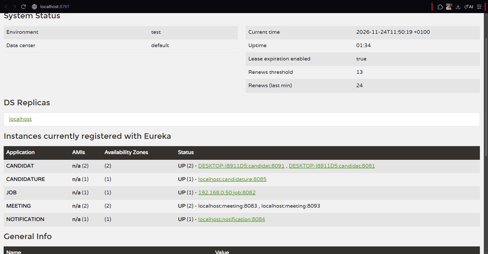

# TP - Service Discovery avec Eureka

## Étudiant

- Nom et prénom : Baha Eddine Ben Kilani
- Classe : 4SSA2
- Travail individuel

## 1. Objectif du TP

L'objectif de ce TP est de mettre en place une architecture
microservices basée sur un serveur de découverte Eureka.

Les différents microservices s'enregistrent auprès du serveur
Eureka afin de permettre leur découverte dynamique.

## 2. Technologies utilisées

- Java 17
- Spring Boot
- Spring Cloud Netflix Eureka
- Maven
- Node.js / Express
- Python / FastAPI
- MySQL
- H2 Database
- Swagger / OpenAPI
- IntelliJ IDEA

## 3. Architecture du projet

- Eureka : serveur de découverte des services.
- Candidat : microservice Spring Boot.
- Candidature : microservice Spring Boot.
- Job : microservice Spring Boot.
- Meeting : microservice Node.js / Express.
- Notification : microservice Python / FastAPI.

## 4. Configuration des ports

| Service | Port(s) | Nombre d'instances |
|---|---|---|
| Eureka Server | 8761 | 1 |
| Candidat | 8081, 8091 | 2 |
| Job | 8082 | 1 |
| Meeting | 8083, 8093 | 2 |
| Notification | 8084 | 1 |
| Candidature | 8085 | 1 |

## 5. Dashboard Eureka

Les cinq microservices sont enregistrés avec succès
auprès du serveur Eureka.

Les services Candidat et Meeting disposent chacun
de deux instances actives sur des ports différents.

Au total, sept instances sont enregistrées avec le statut UP.

URL du serveur Eureka :
http://localhost:8761




## 6. Tests des endpoints

| Microservice | URL | Résultat |
|---|---|---|
| Meeting 1 | http://localhost:8083/api/meetings/hello | Réussi |
| Meeting 2 | http://localhost:8093/api/meetings/hello | Réussi |
| Notification | http://localhost:8084/api/notifications/hello | Réussi |

Les deux instances de Meeting retournent le message suivant :

```json
{
  "message": "hello I'm microservice meeting"
}
```

Le microservice Notification retourne :

```json
{
  "message": "hello I'm microservice notification"
}
```

## 7. Démarrage du projet

1. Démarrer le serveur Eureka sur le port 8761.
2. Démarrer les microservices Spring Boot.
3. Démarrer Meeting avec la commande npm start.
4. Démarrer Notification avec Uvicorn sur le port 8084.
5. Lancer une deuxième instance de Candidat sur le port 8091.
6. Lancer une deuxième instance de Meeting sur le port 8093.
7. Vérifier les instances dans le dashboard Eureka.
8. Tester les endpoints hello.

## 8. Conclusion

Ce TP a permis de mettre en place un mécanisme de découverte
de services avec Eureka dans une architecture microservices
utilisant plusieurs technologies.

Les cinq microservices ont été enregistrés avec succès.
Le fonctionnement de plusieurs instances d'un même service
a également été validé.

Les tests des endpoints Meeting et Notification sont réussis.
